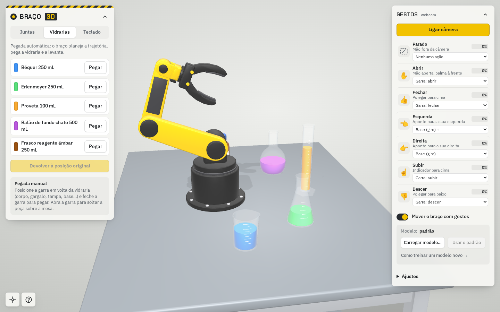

# Braço Robótico 3D

Simulador de um braço robótico de 6 juntas numa bancada de laboratório, direto no navegador.
O braço é controlado por sliders, pelo teclado ou por **gestos na webcam** (modelo do Google Teachable Machine),
e consegue pegar, levantar e soltar vidrarias com detecção de colisão sobre as malhas reais.



**Demo:** https://mfelipedias.github.io/braco-3d/

## Recursos

- **Cena 3D** em [three.js](https://threejs.org): braço, mesa e 5 vidrarias modelados por script no Blender.
- **6 juntas** (base, ombro, cotovelo, flexão e rotação do punho, garra), com leitura do ângulo e marcação do zero.
- **Pegada automática**: cinemática inversa planeja aproximação, pega, levanta e devolve cada vidraria.
- **Pegada manual**: feche a garra em volta de qualquer parte da vidraria; ela só é presa se os dois dedos
  tocarem lados opostos. Abra a garra sobre a mesa para soltá-la (ela cai até o tampo).
- **Colisões** com BVH ([three-mesh-bvh](https://github.com/gkjohnson/three-mesh-bvh)): o braço para ao encostar
  na mesa, no chão ou nas vidrarias (pode ser desligado).
- **Teclado configurável**: teclas e passo (graus por toque) de cada junta, salvos no navegador.
- **Gestos pela webcam**: 7 gestos com ações configuráveis, limiar de confiança e suavização.
- **Modelo de gestos próprio**: treine no Teachable Machine e carregue o `.zip` pela interface para testar.
  O arquivo é lido só no navegador e nunca é enviado ao servidor.
- Interface responsiva (desktop e celular), painéis recolhíveis e ajuda integrada.

## Executar

### Docker (recomendado)

```bash
docker compose up -d --build
# http://localhost:8090
```

A imagem também é publicada no GitHub Container Registry a cada push na `main`:

```bash
docker run -d -p 8090:80 --name braco-3d ghcr.io/mfelipedias/braco-3d:latest
```

### Sem Docker

Qualquer servidor de arquivos estáticos serve a pasta `web/`:

```bash
cd web && python3 -m http.server 8000
# http://localhost:8000
```

> A webcam só funciona em **HTTPS** ou em **localhost** (exigência dos navegadores).
> Para usar os gestos a partir de outro computador, use a demo no GitHub Pages ou coloque o container atrás de um proxy HTTPS.

## Controles

| Ação | Como |
|---|---|
| Girar / deslocar / aproximar a vista | arrastar / botão direito ou dois dedos / rolar |
| Base | <kbd>A</kbd> <kbd>D</kbd> |
| Ombro | <kbd>S</kbd> <kbd>W</kbd> |
| Cotovelo | <kbd>F</kbd> <kbd>R</kbd> |
| Punho (flexão) | <kbd>G</kbd> <kbd>T</kbd> |
| Punho (rotação) | <kbd>Q</kbd> <kbd>E</kbd> |
| Garra fecha / abre | <kbd>Z</kbd> <kbd>X</kbd> |

As teclas podem ser trocadas na aba **Teclado**. Parâmetros de URL: `?vel=2` acelera as animações,
`?pegar=bequer` pega uma vidraria ao abrir a página.

## Gestos

| Classe | Gesto | Ação padrão |
|---|---|---|
| `Parado` | mão fora da câmera | nenhuma |
| `Abrir` | mão aberta, palma à frente | abre a garra |
| `Fechar` | polegar para cima | fecha a garra |
| `Esquerda` | aponta para a sua esquerda | gira a base (+) |
| `Direita` | aponta para a sua direita | gira a base (−) |
| `Subir` | indicador para cima | garra sobe em linha reta |
| `Descer` | polegar para baixo | garra desce em linha reta |

Para treinar um modelo novo e testá-lo no simulador, veja **[docs/treinar-gestos.md](docs/treinar-gestos.md)**.

## Estrutura

```
braco-3d/
├── web/                     # aplicação servida (estática)
│   ├── index.html
│   ├── css/app.css
│   ├── js/
│   │   ├── app.js           # cena, cinemática, colisões, teclado e gestos
│   │   ├── config.js        # juntas, poses, teclas e gestos padrão
│   │   └── ui.js            # avisos, abas, painéis, carregamento, ajuda
│   ├── models/              # GLB exportados do Blender
│   └── modelo-gestos/       # modelo padrão do Teachable Machine (TensorFlow.js)
├── blender/
│   ├── gerar_braco.py       # gera braço → web/models, cenas e previews
│   ├── gerar_vidrarias.py
│   ├── gerar_mesa.py        # roda por último (importa braço e vidrarias)
│   └── cenas/               # arquivos .blend
├── docs/                    # documentação e imagens
├── teachable-machine/       # projeto .tm (local, fora do Git)
├── Dockerfile · nginx.conf · docker-compose.yml
└── .github/workflows/       # GitHub Pages e imagem Docker (GHCR)
```

## Documentação

- [Treinar gestos no Teachable Machine](docs/treinar-gestos.md)
- [Arquitetura e funcionamento](docs/arquitetura.md)
- [Modelos 3D (Blender)](docs/modelos-3d.md)
- [Deploy](docs/deploy.md)

## Tecnologias

three.js 0.169 · three-mesh-bvh 0.8 · TensorFlow.js 1.3 + @teachablemachine/image 0.8.5 · fflate · Blender (bpy) · nginx

O three.js e o three-mesh-bvh ficam em `web/vendor/`; só o TensorFlow.js e o Teachable Machine vêm de CDN (jsDelivr). Não há etapa de build.
