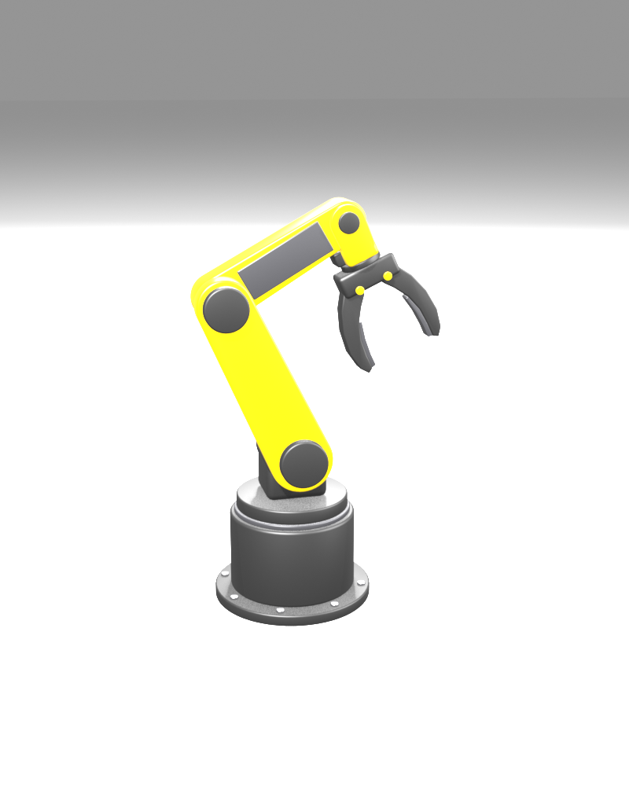
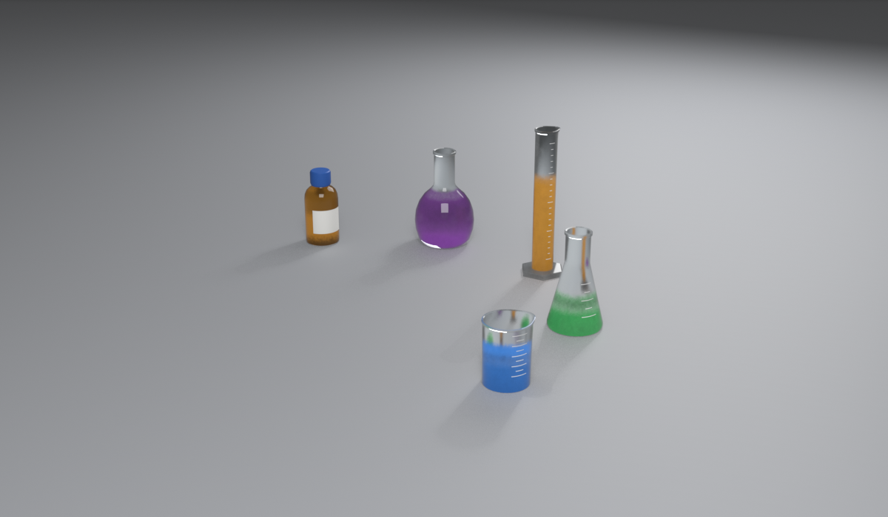
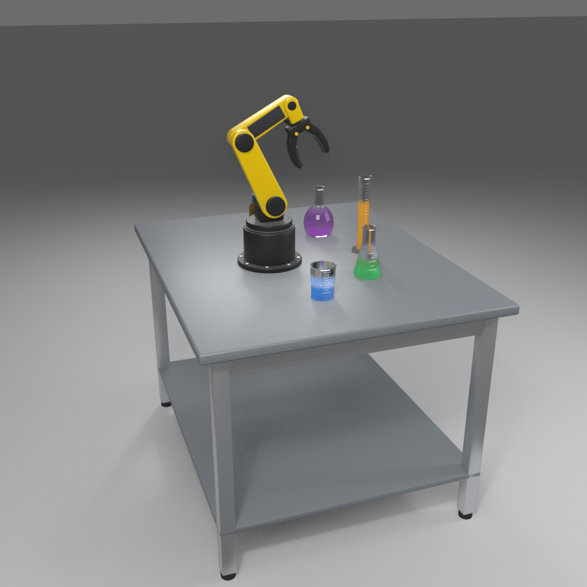

# Modelos 3D (Blender)

Os três modelos são gerados por scripts Python do Blender (`bpy`), a partir da referência
[`img/referencia.jpg`](img/referencia.jpg).

| Script | Gera | Também salva |
|---|---|---|
| `blender/gerar_braco.py` | `web/models/braco_robotico.glb` | `blender/cenas/braco_robotico.blend`, `docs/img/preview_pose_*.png` |
| `blender/gerar_vidrarias.py` | `web/models/vidrarias.glb` | `blender/cenas/vidrarias.blend`, `docs/img/preview_vidrarias.png` |
| `blender/gerar_mesa.py` | `web/models/mesa.glb` | `blender/cenas/cena_completa.blend`, `docs/img/preview_mesa.png` |

Os caminhos são relativos à pasta do repositório. Rode a mesa por último, pois ela importa os outros dois GLB:

```bash
blender -b -P blender/gerar_braco.py
blender -b -P blender/gerar_vidrarias.py
blender -b -P blender/gerar_mesa.py
```

## Contrato com o simulador

O JavaScript depende destes nomes e propriedades personalizadas (*custom properties*, exportadas como `extras`):

**Braço**: empties `J1_Base`, `J2_Ombro`, `J3_Cotovelo`, `J4_Punho`, `J5_Rotacao`, `J6_Dedo_D`, `J6_Dedo_E`,
encadeados nessa ordem. A escala geral é `ESCALA` em `gerar_braco.py`.

**Vidrarias**: um empty `Vidraria_*` por peça, com origem no centro da base e
`graspable = true`, `nome` (texto exibido), `grip_height` e `grip_diameter` (m).
Materiais `Vidro*`, `Liquido*` e `Plastico*` entram na colisão; `Vidro_Ambar` é renderizado âmbar.

**Mesa**: objeto `Mesa` com `top_height` (m) e malha `Mesa_Tampo` (colisão e limites para soltar peças).

| Pose de referência | Vidrarias | Cena completa |
|---|---|---|
|  |  |  |
