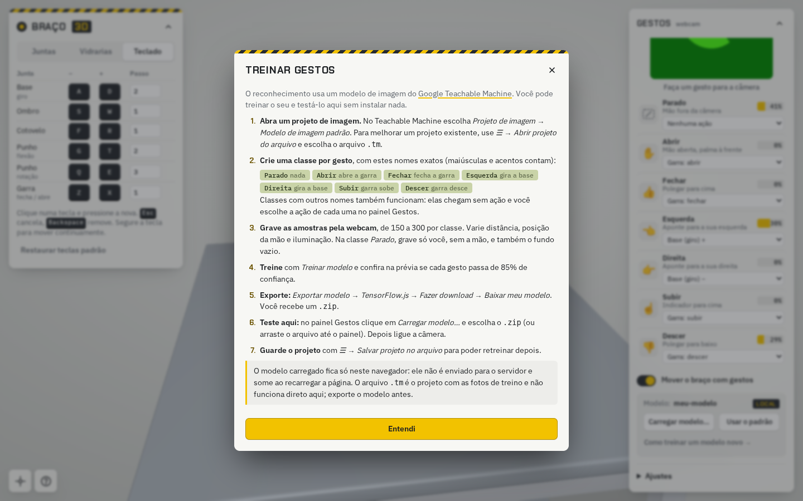

# Treinar gestos no Teachable Machine

O simulador reconhece gestos com um modelo de imagem do
[Google Teachable Machine](https://teachablemachine.withgoogle.com/train/image).
Você pode treinar um modelo novo e testá-lo pela interface, sem mexer no servidor.

## Arquivo de projeto × modelo exportado

| Arquivo | O que é | Onde usar |
|---|---|---|
| `.tm` | projeto com as fotos de treino | abrir no Teachable Machine para retreinar |
| `.zip` (TensorFlow.js) | modelo treinado: `model.json`, `metadata.json`, `weights.bin` | carregar no simulador |

O simulador **não** lê o `.tm`: é preciso exportar o modelo antes.

## Passo a passo

1. **Abra um projeto de imagem.** Em <https://teachablemachine.withgoogle.com/train/image> escolha
   *Projeto de imagem → Modelo de imagem padrão*. Para melhorar o projeto existente use
   *☰ → Abrir projeto do arquivo* e escolha o `.tm` (ex.: `teachable-machine/gestos-braco.tm`).

2. **Crie uma classe por gesto** com estes nomes exatos (maiúsculas e acentos contam):

   | Classe | Gesto sugerido | Ação padrão |
   |---|---|---|
   | `Parado` | mão fora da câmera / fundo vazio | nenhuma |
   | `Abrir` | mão aberta, palma à frente | abre a garra |
   | `Fechar` | polegar para cima | fecha a garra |
   | `Esquerda` | aponta para a sua esquerda | gira a base (+) |
   | `Direita` | aponta para a sua direita | gira a base (−) |
   | `Subir` | indicador para cima | garra sobe |
   | `Descer` | polegar para baixo | garra desce |

   Classes com outros nomes também funcionam: chegam sem ação e você escolhe a ação de cada uma no painel
   **Gestos** (a escolha fica salva no navegador). As ações possíveis são `±` em qualquer junta, abrir/fechar
   a garra e subir/descer/avançar/recuar a garra em linha reta.

3. **Grave as amostras pela webcam**, de 150 a 300 por classe.
   - Varie distância, posição da mão na imagem, inclinação e iluminação.
   - Use o mesmo lugar e a mesma câmera em que o simulador vai ser usado.
   - Em `Parado`, grave você sem a mão levantada **e** o fundo vazio: é a classe que evita movimentos acidentais.
   - Gestos parecidos (ex.: `Fechar` 👍 e `Descer` 👎) precisam de mais amostras e de ângulos variados.

4. **Treine** com *Treinar modelo*. Na prévia, confira se cada gesto passa de **85%** de confiança
   (o limiar padrão do simulador; ajustável em *Gestos → Ajustes*).

5. **Exporte**: *Exportar modelo → TensorFlow.js → Fazer download → Baixar meu modelo*.
   Você recebe um `.zip` (normalmente `tm-my-image-model.zip`).

6. **Teste no simulador**: no painel **Gestos** clique em *Carregar modelo…* e escolha o `.zip`
   (ou arraste o arquivo até o painel; os três arquivos soltos também servem). Depois clique em *Ligar câmera*.
   O nome do modelo aparece com a etiqueta **LOCAL**; *Usar o padrão* volta ao modelo original.

7. **Salve o projeto** com *☰ → Salvar projeto no arquivo* para retreinar depois.

## Privacidade

O modelo carregado é lido apenas no navegador (APIs `File` e TensorFlow.js): nada é enviado ao servidor,
e o modelo some ao recarregar a página. As imagens da webcam também são processadas só localmente.

## Trocar o modelo padrão

Para que um modelo novo vire o padrão para todos, descompacte o `.zip` em `web/modelo-gestos/`
(substituindo `model.json`, `metadata.json` e `weights.bin`), faça commit e refaça o deploy.

## Problemas comuns

| Sintoma | Causa provável |
|---|---|
| “A câmera só funciona em HTTPS…” | página aberta por `http://IP`. Use localhost, HTTPS ou a demo do GitHub Pages. |
| “o arquivo .tm é o projeto…” | foi enviado o projeto; exporte o modelo em TensorFlow.js e envie o `.zip`. |
| “faltou model.json / metadata.json / weights.bin” | `.zip` de outro formato (Keras, TFLite). Exporte como **TensorFlow.js**. |
| Gesto reconhecido, mas o braço não se move | a classe tem um nome diferente do padrão: escolha a ação no painel, ou o interruptor *Mover o braço com gestos* está desligado. |
| Braço se move sozinho | a classe `Parado` tem poucas amostras, ou o limiar de confiança está baixo. |
